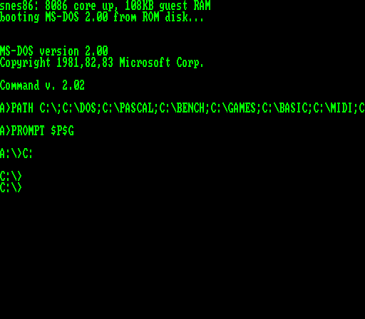
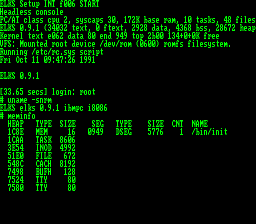

# snes86

Run an IBM PC — MS-DOS and all — on a stock, unmodified SNES.

snes86 is an 8086 PC emulator written from scratch in 65C816 assembly. It boots
real MS-DOS 2.0 from a ROM "disk", renders CGA/MDA text and graphics, turns the
SNES sound chip into a MIDI synth, and runs period DOS software. It even boots
Linux — [ELKS](https://github.com/ghaerr/elks), the Embeddable Linux Kernel
Subset — to a root shell. Each machine ships as a flashable `.sfc` — no special
cartridge chip, no expansion hardware, just a Super Nintendo.

<p align="center">
  <br>
  <sub>MS-DOS 2.0 booting on a stock SNES. More in <a href="docs/COMPATIBILITY.md">COMPATIBILITY.md</a>.</sub>
</p>

## Wait, what?

A Super Nintendo's CPU is a 16-bit 65C816 running around 3.5 MHz. snes86 makes it
impersonate an Intel 8086:

- a threaded-dispatch 8086 interpreter with a lazy-flags model — the guest register
  file lives in the 65C816 direct page, and 8086 FLAGS are only materialized when
  something actually reads them;
- an HLE BIOS — video, disk, keyboard and timer interrupts (INT 10h/11h/12h/13h/16h/
  1Ah) are serviced natively in 65C816 instead of by guest ROM code;
- a 24-bit guest memory model mapped into SNES WRAM, giving DOS ~108 KB;
- booting MIT-licensed MS-DOS 2.0, via an `IO.SYS` we wrote from scratch (Microsoft's
  release ships none for the IBM PC).

See [docs/INTERNALS.md](docs/INTERNALS.md) for how it all actually works — including
the C reference core, the `runpc` host emulator, and the CPU parity harness that
keeps the two implementations honest.

## And yes, it boots Linux

<p align="center">
  <br>
  <sub>ELKS 0.9.1 — kernel and userland executing in place from cartridge ROM.
  <code>uname</code> says <code>ELKS elks 0.9.1 ibmpc i8086</code>.</sub>
</p>

`make elks` builds a second ROM that boots [ELKS](https://github.com/ghaerr/elks),
the Linux-family kernel for real-mode x86, on a 172 KB machine: the kernel and the
applications execute **in place from cartridge ROM** (only their data lives in RAM),
the root filesystem is an in-ROM ROMFS, and you land at `login:` about two minutes
after power-on. Log in as `root`, run `uname`, `ls`, `meminfo` — it's a real Unix
prompt on a Super Nintendo. How the ROM-execute-in-place machine works is in
[docs/INTERNALS.md](docs/INTERNALS.md#booting-linux-the-elks-machine).

There's also a [FreeDOS 1.3 build](docs/COMPATIBILITY.md#freedos-on-the-snes)
(`make freedos`).

## How do we know it's correct?

The same 8086 core exists twice: once in portable C (`core-c/`) and once in 65C816
assembly (`snes/cpu.asm`). Both are held to the same standard:

- The C core passes 3,007,000 / 3,007,000 of the
  [SingleStepTests 8088 v2](https://github.com/SingleStepTests/8088) vectors — all
  323 opcode files, including undocumented opcodes, the REP-IDIV sign quirk,
  microcode-exact divide-error flags, and the 8088 DAA/AAA hardware quirks.
- The 65C816 core is diffed against the C core in lockstep: `test/parity.sh` runs
  random 8086 instruction streams through both and compares all 14 guest registers
  after every instruction. The automated suite runs one 1200-instruction stream per
  pass; manual sweeps of 12–20+ seeds × up to 2000 instructions found zero divergence.

## Try it

Flash `snes/build/msdos.sfc` to a flashcart, or load it in an accurate emulator
such as [Mesen](https://www.mesen.ca/). You boot straight to `C:\>`. For Linux,
flash `snes/build/elks.sfc` instead and log in as `root`. There's also a
FreeDOS 1.3 build (`freedos.sfc`) for the 172 KB machine.

The public ROM ships only free software: our own snes86 tools (with Turbo Pascal
source) — a MIDI player, a Sokoban game, a BMP picture viewer, benchmarks — plus a
generated demo tune. To
run your own DOS programs, drop them in `snes/userware/` and rebuild (see
[docs/BUILDING.md](docs/BUILDING.md)).

## Build

```sh
cd snes && make msdos        # -> build/msdos.sfc     (the public ROM)
cd snes && make freedos      # -> build/freedos.sfc   (FreeDOS 1.3, 172 KB)
cd snes && make elks         # -> build/elks.sfc      (Linux: the ELKS ROM)
```

Prerequisites, the other build targets, and the self-hosted MS-DOS toolchain are in
[docs/BUILDING.md](docs/BUILDING.md).

## Docs

| doc | what |
|---|---|
| [docs/INTERNALS.md](docs/INTERNALS.md) | how an 8086 runs on a 65C816; the HLE BIOS; runpc; CPU parity testing |
| [docs/BUILDING.md](docs/BUILDING.md) | build the ROM + add your own software |
| [docs/COMPATIBILITY.md](docs/COMPATIBILITY.md) | what runs, and the SNES-as-MIDI-synth feature |
| [docs/FUTURE.md](docs/FUTURE.md) | where this could go next |

## Legal & credits

MS-DOS 2.0 is MIT-licensed ([microsoft/MS-DOS](https://github.com/microsoft/MS-DOS)).
The public ROM contains only freely redistributable software — no copyrighted DOS
applications. Our own tools ship with source. The ELKS ROM bundles the unmodified
official [ELKS](https://github.com/ghaerr/elks) release images (GPL-2.0), fetched at
build time rather than committed here; ELKS's source lives upstream.

- Test vectors: [SingleStepTests/8088](https://github.com/SingleStepTests/8088) v2
  by Daniel Balsom, captured from a real AMD D8088.
- The microcode division routines and the undefined-flag behavior of the BCD
  instructions in `core-c/src/x86.c` are ported from
  [MartyPC](https://github.com/dbalsom/martypc) (MIT, © 2022–2026 Daniel Balsom),
  which derives from reenigne's 8086 microcode disassembly.
- Inspired by Daniel Palmer's LinuxMD (Linux on the Mega Drive).

## Disclaimer

snes86 was built for fun, with the help of AI, and is provided **AS IS** — no
warranty of any kind, express or implied; no guarantee it is correct, complete,
or fit for any purpose. If you flash it, run it, or build on top of it, whatever
happens — to your cartridge, your console, your save files, or your weekend — is
on you.
