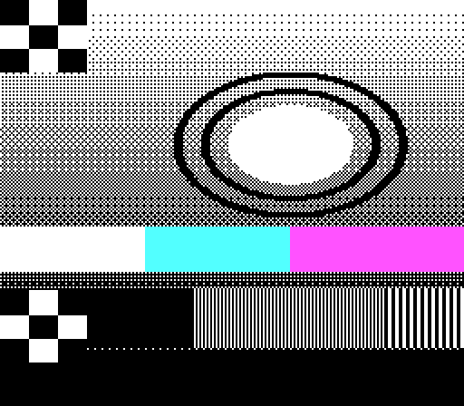
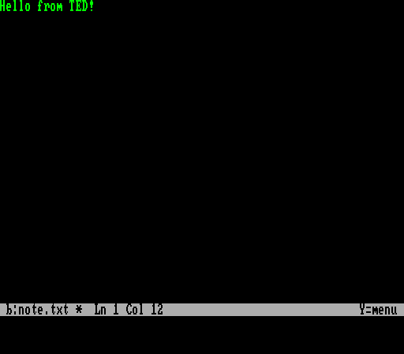
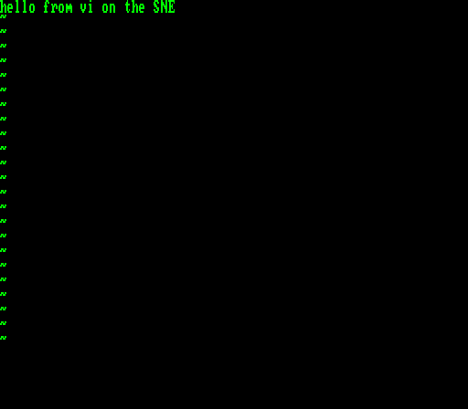
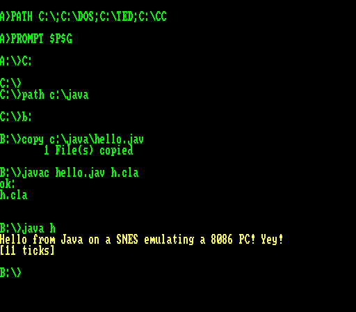
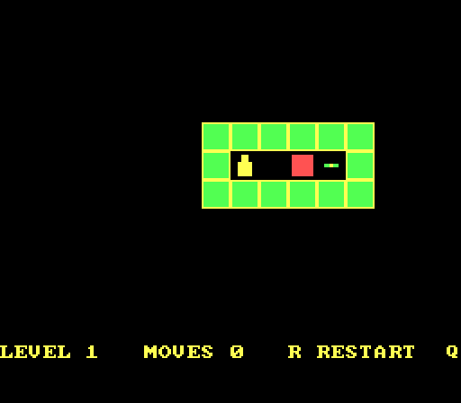
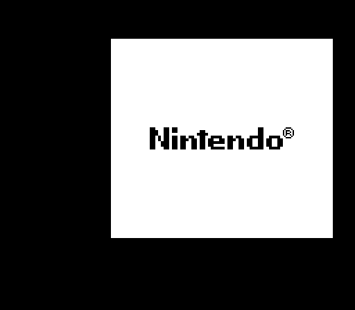
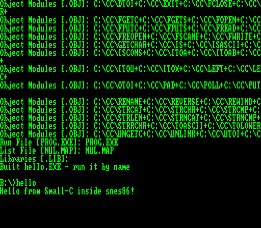

# Apps

This folder contains all of our custom tools for this project. This is just a bunch of random, funny stuff, that we created to demo and/or evaluate the capabilities of our emulator. Some of them (like the Java one) came up as a joke between friends, but some were actually a necessity, like our text editor (`EDLIN` sucks).

> Please note that all tools are shipped with the normal project build, but not everything works without a `B:` drive. For example, you can't build Java or C code without a writeable disk.. obviously.

## MIDI

This is our MIDI playback pair, and the reason the SNES is your sound card: the SPC-700 audio chip runs an 8-voice General MIDI synth, and the guest sees a small MIDI card. It works in two steps because 1980s math was expensive: `MIDCONV` converts a Standard MIDI File (format 0) into a `.SNM` packet stream (doing the slow real-number timing math once) so `MIDPLAY` can be a fast dumb loop that streams packets to the synth. It ain't perfect, but works. You can test it as such:

```
C:\> CD MIDI
C:\MIDI> MIDCONV YOURS.MID YOURS.SNM      (converts the MID file into our SNM format)
C:\MIDI> MIDPLAY DEMO.SNM                 (plays the SNM format)
```

[▶ Watch the demo tune](../docs/assets/mididemo.mp4). We used Beethoven's "Ode to Joy", sequenced as a CC0 MIDI, played through the SPC-700. Even the PC speaker routes to the synth, so programs that beep make sound. See [INTERNALS](INTERNALS.md#the-snes-is-your-sound-card) for how the card and synth work.

## VIEW

This is a picture viewer we created: it decodes BMP (8/24/32-bit uncompressed) and PCX (8-bit RLE) files pixel-by-pixel *on the emulated 8086* and dithers them onto the CGA screen — 640×200 halftone by default, 320×200 four-colour if you ask. A full paint takes a few minutes of the image crawling up the screen, exactly as the eighties intended. L/R pan the 512-pixel window across the 640. You can test it as such:

```
C:\> CD VIEW
C:\VIEW> VIEW CARD.BMP        (the generated test card)
C:\VIEW> VIEW CARD.PCX        (same pixels, PCX decoder)
C:\VIEW> VIEW CARD.BMP 4      (320x200 four-colour mode)
C:\VIEW> VIEW *.BMP           (slideshow: any key = next, ESC = quit)
```



Your own images: any uncompressed BMP up to 2048 pixels wide (convert with `sips -s format bmp in.jpg --out out.bmp` on macOS), dropped into `user/` → `C:\USER`.

## TED

This is a visual text editor we created in Turbo Pascal, built to be driven with a game pad: the d-pad moves the cursor, SELECT opens the on-screen keyboard for typing, START is Enter, and **Y opens the menu** (Save / Save As / Load / Search / Goto / Quit) so commands cost zero keyboard trips. Keystrokes land in ~50 ms — live typing, no interpreter tricks, it's compiled Pascal. You can test it as such:

```
C:\> TED B:NOTE.TXT
```

> Note: TED is on the PATH, so it works from anywhere.

Save to `B:` and the file lives in battery-backed cartridge SRAM: power off, power on, it's still there, like a game save.



## VI

Yes, a real vi. This is [levee](https://github.com/Orc/levee) 4.0b, David Parsons' tiny vi clone, cross-compiled for MS-DOS 2.0 with Open Watcom and given a BIOS screen layer so it feels at home here. Modal editing, `dd`/`yy`/`p`/`u`, `/search`, `:wq`, wildcard `VI *.TXT` with `:n` — the whole muscle-memory package, on a game console. You can test it as such:

```
C:\> VI B:NOTE.TXT
```

> Note: VI is on the PATH, so it works from anywhere. The edit buffer is 16 KB (bigger files open read-only), and there's no `:!` — there's no shell to shell out to.

Like TED, saving to `B:` writes battery-backed cartridge SRAM. Provenance and license live in [vi/ORIGIN](vi/ORIGIN.md).



## JAVA + JAVAC

Yes, this is a Java runtime (-ish) running inside a 8086 emulator running MS-DOS inside a Super Nintendo videogame console. Don't ask how we got here. It's the "Write once, run anywhere", but taken literally.

`JAVA` is a Java class-file interpreter: it runs the bytecode a real `javac` produces. Compile on any modern machine with `javac --release 8`, rename the `.class` to `.CLA` (DOS 8.3 can't hold `.class`), and it should work. Emphasis on _should_:

- **Scope**: static methods of one class, 32-bit `int` arithmetic (hi/lo 16-bit pairs, with the hot ops hand-written in 8086), `int[]`/`boolean[]` arrays, `String` literals, `StringBuilder` concatenation (`"n=" + i`), `System.out.println/print`, `System.in.read()`. No `long`/`float`, no user-defined objects, no exceptions, no garbage collector (nothing lives long enough to need one). Unsupported bytecode stops with a message naming the opcode.
- Built with `javac --release 8` — newer targets emit `invokedynamic` string concatenation, which is deliberately out of scope. The compiled class files are committed, so the ROM builds without a JDK.

Just for fun, we also created a small Java compiler (`JAVAC`) for the same subset, running on the machine itself. It is written in C (`apps/java/javac.c`), compiled to a DOS binary by the 1988 Small-C toolchain running on MS-DOS 2.0 *inside our own emulator* (the clang build of the same source emits byte-identical class files, which also pass a modern desktop JVM's verifier). The war story is [here](../docs/notes/JAVAC-PORTING.md).

> No, you don't need to use our Java compiler. You can just build code with your own host machine `javac` and push it inside the emulator, and it should work just fine... for very basic things!

Ironically, compiling takes only a few seconds; *running* is the slow part. Go figure. You can test it as such:

```
C:\> CD JAVA
C:\JAVA> JAVA HELLO                      run the shipped bytecode
C:\JAVA> JAVA SIEVE                      1899 primes, timed in BIOS ticks
C:\JAVA> JAVAC HELLO.JAV B:HELLO.CLA     compile Java on a SNES
C:\JAVA> JAVA B:HELLO
```

> Note: `C:` is read-only, so JAVAC's output must go to the writable `B:`.



## SOKOBAN

Our CGA puzzle game, with source — push the crates onto their targets, d-pad to move. You can test it as such:

```
C:\> CD SOKOBAN
C:\SOKOBAN> SOKOBAN
```



## GB

Our Game Boy emulator: a 15 KB pure-8086 `.COM` running DMG carts inside DOS inside a SNES — a Game Boy, four machines deep. It was born in this repo, moved out to grow up in its own project ([gb8086](https://github.com/rgsilva/gb8086), where it passes Blargg's cpu_instrs 11/11), and now ships back home. Three of our own homebrew test carts come along; game ROMs are bring-your-own (32 KB, no MBC) via `user/` → `C:\USER`. You can test it as such:

```
C:\> CD GB
C:\GB> GB SMOKE.GB            (CPU smoke-test cart)
C:\GB> GB GFX.GB              (graphics test cart)
C:\GB> GB JOY.GB              (joypad test cart)
C:\GB> GB C:\USER\YOURS.GB    (bring your own)
```

Flags and the gory details are in [gb/README](gb/README.md).



## BENCH

The benchmarks and test cards, mostly useful for regression hunting and bragging: `SIEVE` (the BYTE sieve, ten iterations), `HELLO`, and the two CGA test cards `CGATEST` (320×200 mode 4) and `CGA6TST` (true 640×200 mode 6 — any key exits back to DOS).

```
C:\> CD BENCH
C:\BENCH> SIEVE
C:\BENCH> CGA6TST
```

## C compiler

We provide the Small-C toolchain (public-domain compiler + assembler, the MIT MS-DOS linker, runtime, samples) → `C:\CC`. Compiles and runs C entirely inside the emulated machine at the stock 108 KB. You can use it like this:

```
C:\> B:
B:\> COPY C:\CC\HELLO.C
B:\> CC HELLO                  (this may take over 10 minutes)
B:\> HELLO                     (run compiled binary)
Hello from Small-C inside snes86!
```

The pipeline, called by `CC.BAT`, is three real programs (`SCC`, `ASM` and `LINK`). Two samples ship **with source** in `C:\CC`: `HELLO.C` and `SIEVE.C`.



Some extra technical details are provided [here](cc/README.md).

--

# Building them

`make apps` from the repo root runs the whole loop: rebuild every tool from source and verify (see [TESTING](../docs/TESTING.md)).

Each tool folder holds its own source, any generators it owns, and a Makefile with two targets:

- `make stage` — populate `<tool>/build/` with **exactly** what ships on the C: drive as `C:\<TOOL>`, compiling the binaries from source as needed (no binaries are committed). Source code is only added to the final image if we can build it inside the emulator, otherwise it's unnecessary.
- `make recompile` — rebuild the binary from source, most of them by driving the compilers inside `runpc`, our own emulated MS-DOS 2.0. External tools such as Turbo Pascal 3 or Open Watcom are fetched, but not committed. This is mostly due to licensing - for example, Borland/Embarcadero retain all rights to TP3, so we can't really redistribute it here.
