# What runs on snes86

snes86 runs ordinary DOS software — it emulates an 8086 and an IBM-PC-class BIOS, so
period programs generally just work. This page lists what's been exercised.

Two things to keep in mind:

- The public ROM ships only free software (our own tools + a demo). Everything else
  below is bring-your-own: drop it in `snes/userware/` and rebuild (see
  [BUILDING.md](BUILDING.md)). A "✅ tested" mark means the emulator runs it, not that
  it's included.
- Everything here was verified against the cycle-accurate Mesen emulator. Real
  hardware is still pending — see [Help wanted](#help-wanted).

## Gallery

All captured from snes86 running in Mesen.

<table>
<tr>
<td align="center">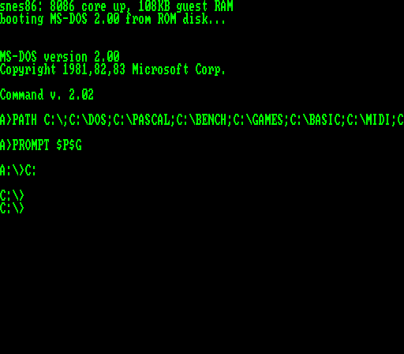 MS-DOS 2.0 booting to <code>C:\></code></td>
<td align="center">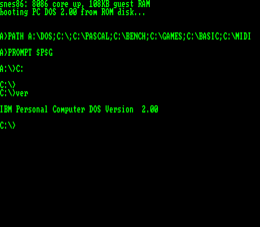 PC DOS 2.00 — the original bring-up target</td>
</tr>
<tr>
<td align="center">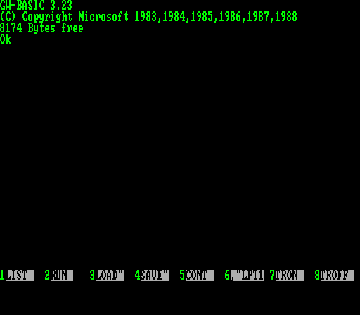 GW-BASIC 3.23</td>
<td align="center">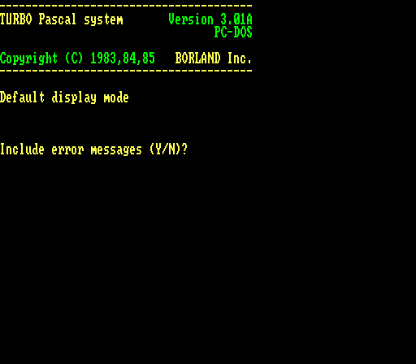 Turbo Pascal 3.01 — the compiler that builds our tools</td>
</tr>
<tr>
<td align="center">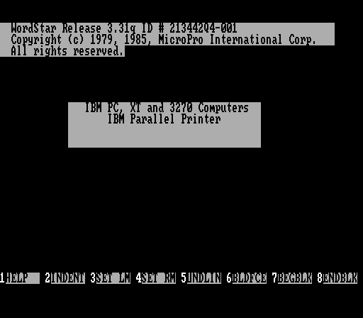 WordStar 3.31</td>
<td align="center">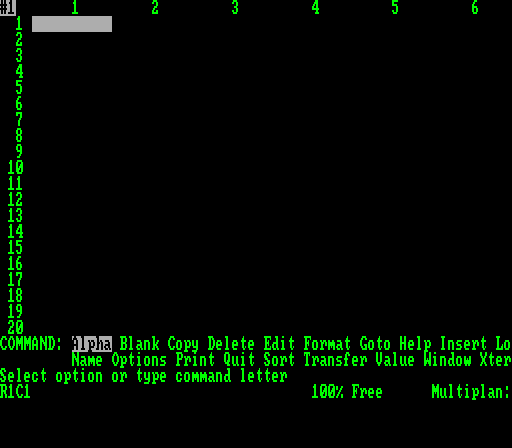 Multiplan</td>
</tr>
<tr>
<td align="center"> Zork I — Infocom interactive fiction</td>
<td align="center"> Zork II: The Wizard of Frobozz</td>
</tr>
<tr>
<td align="center">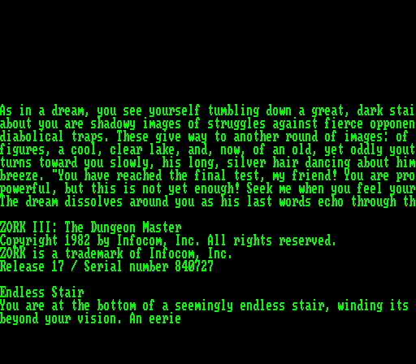 Zork III: The Dungeon Master</td>
<td align="center"> Planetfall</td>
</tr>
<tr>
<td align="center">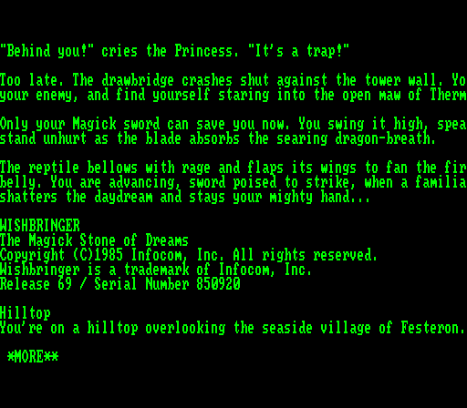 Wishbringer</td>
<td align="center">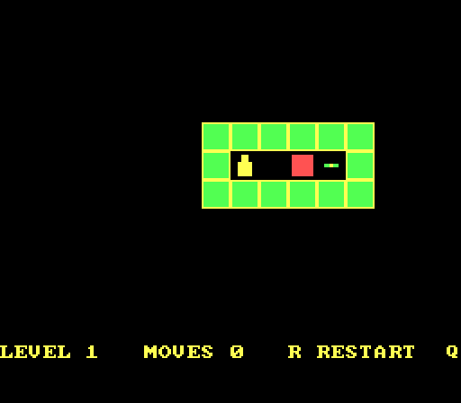 Sokoban — our own CGA game, with source</td>
</tr>
<tr>
<td align="center">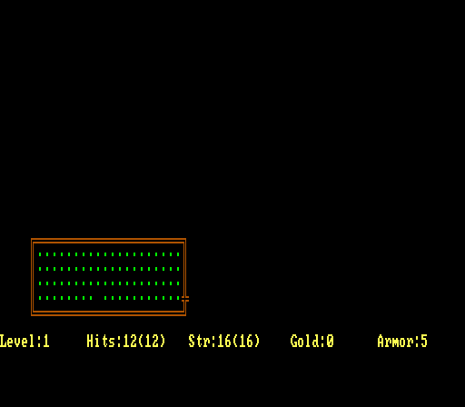 Rogue — the roguelike that named the genre (needs BIGMEM)</td>
<td align="center">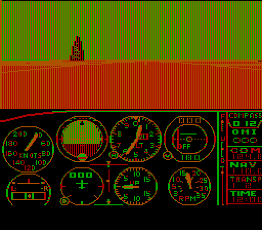 Microsoft Flight Simulator 1 (<code>make fs</code>)</td>
</tr>
<tr>
<td align="center">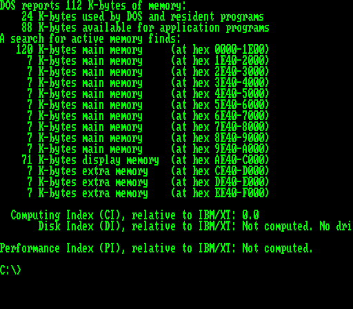 Norton SI — Computing Index 0.0 vs the IBM/XT</td>
<td align="center"> MIDPLAY — the SNES as a MIDI synth</td>
</tr>
<tr>
<td align="center"> GB.COM — a Game Boy inside DOS inside a SNES: the boot logo, four machines deep</td>
<td align="center">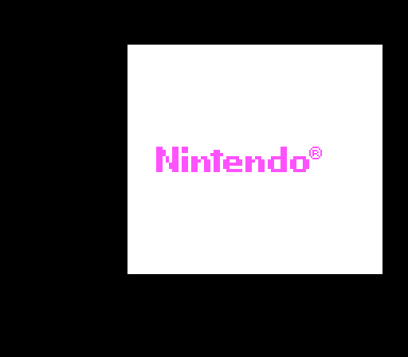 the same logo mid-fade — GB shades through CGA's palette, wrong on purpose</td>
</tr>
</table>

> 🎬 The MIDI synth is best heard, not screenshotted — there's a short clip of the demo
> tune playing in [The SNES is your sound card](#the-snes-is-your-sound-card) below.

## Tested software

| category | software | status | notes |
|---|---|---|---|
| OS / shell | MS-DOS 2.0 (MIT) | ✅ shipped | `DIR`, `PATH`, `PROMPT`, batch files, `VER`, redirection |
| | PC DOS 2.00 | ✅ tested | the original bring-up target; MS-DOS ships instead, but `.IFDEF PCDOS` still boots it |
| Our tools | MIDPLAY / MIDCONV | ✅ shipped | the SNES-MIDI synth (below), with source |
| | SOKOBAN | ✅ shipped | our own CGA-graphics game, with source |
| | SIEVE / BENCH / HELLO / CGATEST | ✅ shipped | our benchmarks + demos, with source |
| | GB.COM | ✅ tested | our Game Boy emulator ([`gbdos/`](../gbdos)): Blargg's cpu_instrs 11/11, dmg-acid2 ~90%, boot-ROM logo above |
| Languages | GW-BASIC 3.23 | ✅ tested | interpreter loads and runs |
| | Turbo Pascal 3 | ✅ tested | the compiler that builds our own tools |
| Applications | WordStar 3.31 | ✅ tested | full-screen editor, overlays load from C: |
| | Multiplan | ✅ tested | spreadsheet grid, `.LOD`/`.SYS` overlays |
| Interactive fiction | Zork I–III, Planetfall, Leather Goddesses, Hitchhiker's Guide, Wishbringer | ✅ tested | Infocom's later 8086 interpreter |
| Games | Rogue | ✅ tested* | *needs BIGMEM (see [Memory](#memory)) |
| | Microsoft Flight Simulator 1 | ✅ tested | self-booting disk (`make fs`), not a DOS program |
| Benchmarks | Norton SI, CPUBENCH | ✅ tested | CPU/system info + timing loops |

If you get something interesting running, we'd love to hear about it.

## The SNES is your sound card

snes86's headline trick beyond "it boots DOS": it turns the SNES's SPC-700 audio chip
into an 8-voice General MIDI synthesizer, and exposes a small MIDI card to the guest.

  
   ▶ The demo tune played through the SPC-700 — click to watch (Beethoven's
  "Ode to Joy", sequenced as a CC0 MIDI, ~0.4 MB).

- MIDPLAY streams music to the synth. Point it at a converted song:
  `MIDPLAY C:\MIDI\DEMO.SNM`.
- MIDCONV converts a Standard MIDI File (`.MID`, format 0) into the `.SNM` packet
  stream MIDPLAY plays. (The conversion does slow real-number math once, so playback
  can be a fast dumb loop.)
- The public ROM includes a generated demo tune — a public-domain melody sequenced by
  the build as an original CC0 MIDI. Type `PLAY` at `C:\>`.
- Even the PC speaker is wired to the synth, so programs that beep make sound.

Both tools ship with Turbo Pascal source in `C:\MIDI`. See
[INTERNALS.md](INTERNALS.md#the-snes-is-your-sound-card) for how the card and synth
work. Bring your own `.MID` files, convert them, and the SNES plays them.

## Memory

The default guest has ~108 KB of conventional RAM — enough for MS-DOS plus the
software above. A handful of memory-hungry titles need more. The BIGMEM build
(`make big`) extends the guest to 172 KB using cartridge SRAM, which revives Rogue.
BIGMEM is an experiment; most software needs only the default build.

## Known limitations

- No EGA/VGA — the display is CGA/MDA-class (text modes + CGA graphics 4/5/6).
- Disk is a fixed ROM image (A:) plus writable SRAM (B:) and a hard-disk image (C:);
  there's no real removable media.
- Speed is period-appropriate, roughly IBM PC/XT territory, not instantaneous.
- Copyrighted DOS software is not distributed — you supply your own.

## Help wanted

- Real hardware. Everything here was verified in Mesen. If you flash the ROM to a cart
  and boot it on a real SNES/Super Famicom, please report what you see — it's the one
  thing we haven't been able to check.
- Videos and captures welcome. Recordings of DOS software (or the MIDI synth) running
  on snes86 are genuinely useful, and fun. Share them.
