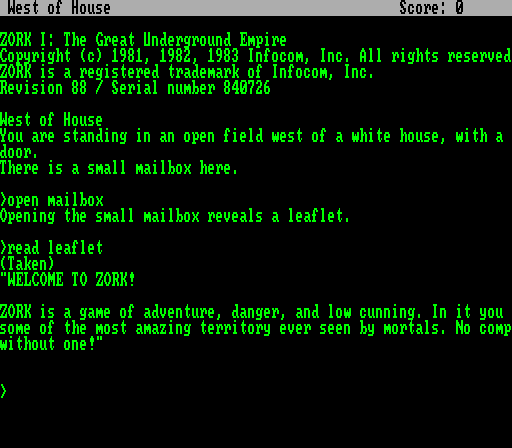
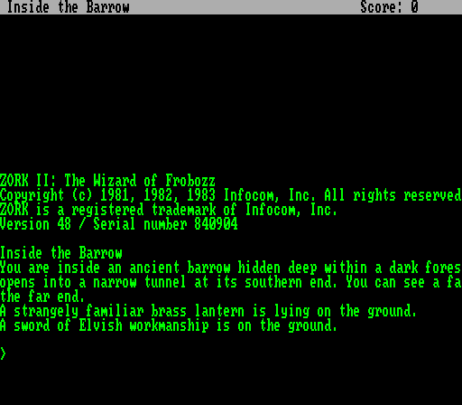
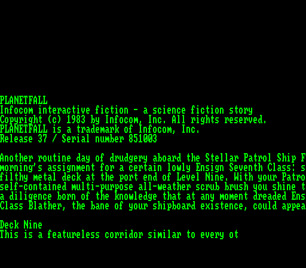
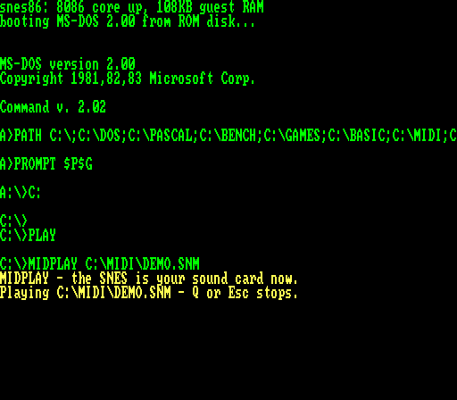
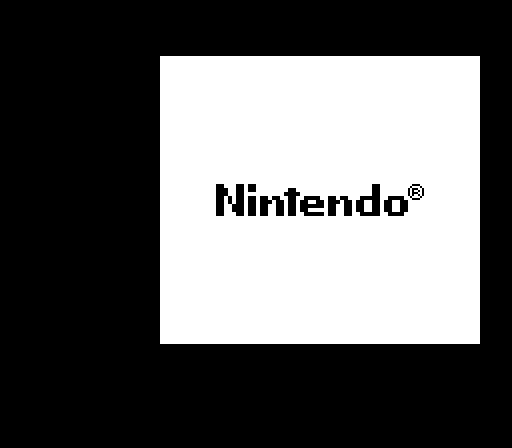
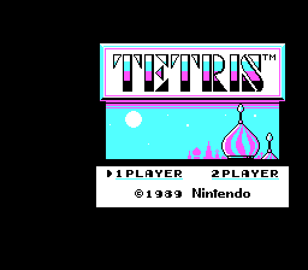
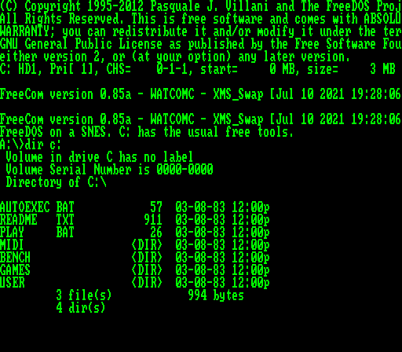
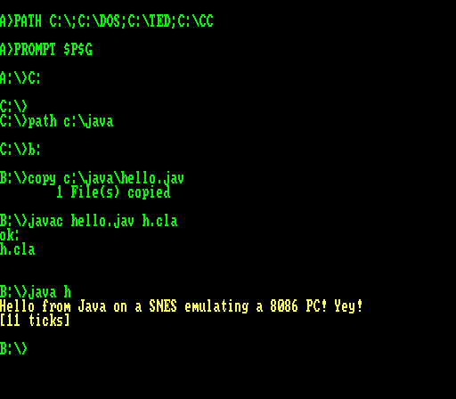
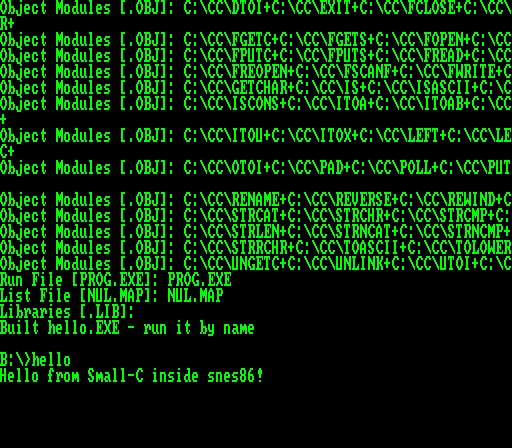
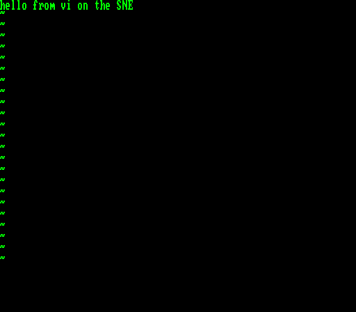

# What runs on snes86

snes86 runs ordinary DOS software, as it emulates an 8086 and an IBM-PC-class BIOS, so period programs generally just work. This page lists what's been exercised, but obviously it's far from complete.

Two things to keep in mind:

- The public ROM ships only free software: our own tools plus public-domain third-party packages (the Small-C toolchain, the MIT MS-DOS utilities), with provenance in the per-package READMEs. Everything else below is bring-your-own: drop it in `user/` and rebuild (see [BUILDING](BUILDING.md)). A "✅ tested" mark means the emulator runs it, not that it's included.
- Everything here was verified against the cycle-accurate Mesen emulator. Real hardware is still pending — see [Help wanted](#help-wanted).

## Gallery

All captured from snes86 running in Mesen.

<table>
<tr>
<td align="center"> MS-DOS 2.0 booting to <code>C:\></code></td>
<td align="center"> PC DOS 2.00 — the original bring-up target</td>
</tr>
<tr>
<td align="center"> GW-BASIC 3.23</td>
<td align="center"> Turbo Pascal 3.01 — the compiler that builds our tools</td>
</tr>
<tr>
<td align="center"> WordStar 3.31</td>
<td align="center"> Multiplan</td>
</tr>
<tr>
<td align="center"> Zork I — Infocom interactive fiction</td>
<td align="center"> Zork II: The Wizard of Frobozz</td>
</tr>
<tr>
<td align="center"> Zork III: The Dungeon Master</td>
<td align="center"> Planetfall</td>
</tr>
<tr>
<td align="center"> Wishbringer</td>
<td align="center"> Sokoban — our own CGA game, with source</td>
</tr>
<tr>
<td align="center"> Rogue — the roguelike that named the genre (needs the big SA-1 machine)</td>
<td align="center"> Microsoft Flight Simulator 1 (<code>make boot DISK=disks/fs1.img</code>)</td>
</tr>
<tr>
<td align="center"> Norton SI — Computing Index 0.0 vs the IBM/XT</td>
<td align="center"> MIDPLAY — the SNES as a MIDI synth</td>
</tr>
<tr>
<td align="center"> GB.COM — a Game Boy inside DOS inside a SNES: the boot logo, four machines deep</td>
<td align="center"> Tetris® (1989) title screen — a real cartridge running on GB.COM, on the SNES</td>
</tr>
<tr>
<td align="center"> ELKS 0.9.1 — Linux on the SNES: boot, <code>login: root</code>, <code>uname</code>, <code>meminfo</code>. Kernel and apps execute in place from cartridge ROM (<code>make elks</code>)</td>
<td align="center"> FreeDOS 1.3 — kernel + FreeCOM booting to <code>A:\></code> on the 300 KB SA-1 machine, reading the C: tools (<code>make freedos</code>)</td>
</tr>
<tr>
<td align="center"> TED — our controller-first text editor, mid-edit on <code>B:NOTE.TXT</code>. The B: drive is battery-backed cartridge SRAM: quit, power off, and the file is still there, like a game save
<td align="center"> JAVAC.EXE + JAVA.COM — the SNES compiles Java and runs it: JAVAC building <code>HELLO.JAV</code> into bytecode on the machine itself, then JAVA interpreting the result (<code>C:\JAVA</code>)</td>
</tr>
<tr>
<td align="center"> CC — the public-domain Small-C toolchain compiling and running <code>HELLO.C</code> on the battery-backed B: drive, ~14 minutes of authentic 1982 build time (measured on the machine) (<code>C:\CC</code>)</td>
<td align="center"> VI — levee 4.0b, a real vi, mid-insert with the tilde column: BSD-licensed, cross-compiled for MS-DOS 2.0 with Open Watcom, on the PATH (<code>C:\VI</code>)</td>
</tr>
<tr>
<td align="center"> VIEW.COM — our Turbo Pascal BMP/PCX viewer rendering the generated test card in CGA mode 4: 320×200 in palette 1 (cyan/magenta/white), decoded pixel-by-pixel on the emulated 8086 in hand-written machine code — the full paint takes ~12 minutes of watching it crawl up the screen, exactly as the eighties intended. <code>VIEW CARD.BMP</code> without the <code>4</code> renders the 640×200 mode-6 halftone instead (M10p6)</td>
</tr>
</table>

## Tested software

| category | software | status | notes |
|---|---|---|---|
| OS / shell | MS-DOS 2.0 (MIT) | ✅ shipped | `DIR`, `PATH`, `PROMPT`, batch files, `VER`, redirection; the MIT utilities (`CHKDSK`, `DEBUG`, `EDLIN`, `FIND`, `SORT`, `MORE`) ship in `C:\DOS` |
| | ELKS 0.9.1 (Linux) | ✅ shipped | its own ROM (`make elks`): boots to a root shell; `sh`, `uname`, `ls`, `meminfo`, … — see [Linux on the SNES](#linux-on-the-snes-elks) |
| | FreeDOS 1.3 | ✅ shipped | its own ROM (`make freedos`, the SA-1 machine): kernel + FreeCOM to `A:\>`, runs the C: tools — see [FreeDOS on the SNES](#freedos-on-the-snes) |
| | PC DOS 2.00 | ✅ tested | the original bring-up target; MS-DOS ships instead, but `.IFDEF PCDOS` still boots it |
| Our tools | MIDPLAY / MIDCONV | ✅ shipped | the SNES-MIDI synth (below), with source |
| | SOKOBAN | ✅ shipped | our own CGA-graphics game, with source |
| | SIEVE / HELLO / CGATEST / CGA6TST | ✅ shipped | our benchmarks + CGA test cards in `C:\BENCH`, with source |
| | TED | ✅ shipped | our controller-first text editor (Turbo Pascal, with source) in `C:\TED`, on the PATH: modeless, Y-button menu, ~50 ms keystrokes, plus keyboard-only bindings (F1 help, F2 save, F5 search … and Ctrl fallbacks); saving to `B:` writes battery-backed cartridge SRAM |
| | VIEW | ✅ shipped | our BMP/PCX picture viewer (Turbo Pascal, with source): 640×200 ordered-dither halftone or 320×200 four-colour in either CGA palette (`VIEW PIC.BMP 4 0` for green/red/brown), wildcard slideshows (`VIEW *.BMP`); `C:\VIEW` ships generated test cards |
| | JAVA | ✅ shipped | our Java class-file interpreter (Turbo Pascal, with source): runs real `javac --release 8` bytecode — `C:\JAVA` ships Hello/Fib/Sieve/Concat/Guess samples |
| | JAVAC | ✅ shipped | our Java compiler running ON the machine (C, built by Small-C 2.2 on MS-DOS 2.0 inside the emulator): `JAVAC HELLO.JAV B:HELLO.CLA` then `JAVA B:HELLO` — the SNES compiles Java and runs it; output byte-identical to the clang build of the same source |
| | VI | ✅ shipped | a real vi — levee 4.0b (BSD-style license, see [apps/vi/ORIGIN](../apps/vi/ORIGIN.md)) cross-compiled for MS-DOS 2.0 with Open Watcom: modal editing, `dd`/`p`/`u`/`/search`/`:wq`, wildcard `:n` chains, in `C:\VI` and on the PATH |
| | GB.COM | ✅ shipped | our Game Boy (DMG) emulator — a 15 KB pure-8086 `.COM` in `C:\GB`, with source ([apps/gb](../apps/gb/README.md)); developed in its own repo, [gb8086](https://github.com/rgsilva/gb8086), and shipped here again with homebrew test carts (bring your own game ROMs — 32 KB no-MBC). Passes Blargg's cpu_instrs 11/11; the shots above are it |
| Third-party | Small-C toolchain | ✅ shipped | public-domain C compiler + assembler + the MIT 1982 linker in `C:\CC`: `CC HELLO` compiles, links and runs C on the 108 KB machine (~14 min at SNES speed, measured); samples ship with source — the machine can build them; provenance and hashes in [apps/cc/README](../apps/cc/README.md) |
| Languages | GW-BASIC 3.23 | ✅ tested | interpreter loads and runs |
| | Turbo Pascal 3 | ✅ tested | the compiler that builds our own tools |
| Applications | WordStar 3.31 | ✅ tested | full-screen editor, overlays load from C: |
| | Multiplan | ✅ tested | spreadsheet grid, `.LOD`/`.SYS` overlays |
| Interactive fiction | Zork I–III, Planetfall, Leather Goddesses, Hitchhiker's Guide, Wishbringer | ✅ tested | Infocom's later 8086 interpreter |
| Games | Rogue | ✅ tested* | *needs the big machine (see [Memory](#memory)) |
| | Tetris (Game Boy, 1989) | ✅ tested | runs *inside* [GB.COM](../apps/gb/README.md) (`C:\GB`) — playable on the host core, title screen captured on the SNES; the cartridge ROM is copyrighted, bring your own |
| | Microsoft Flight Simulator 1 | ✅ tested | self-booting disk (`make boot DISK=disks/fs1.img`), not a DOS program |
| Benchmarks | Norton SI, CPUBENCH | ✅ tested | CPU/system info + timing loops |

If you get something interesting running, we'd love to hear about it.

## FreeDOS

`make freedos` builds a third-OS ROM: [FreeDOS](https://www.freedos.org/) 1.3 on the 300 KB SA-1 machine. It cannot run on the public ROM's machine at all — the kernel dies during init at 108 KB (measured on the host core first), and 172 KB was its exact floor — so it rides the biggest board in the fleet and inherits that board's SA-1 requirement.

- **Boot** lands at a FreeCOM `A:\>` prompt; the C: drive is the same free image as the MS-DOS ROM, so `DIR C:`, the benchmarks and the MIDI tools are all there.
- **B: works**, which is new: on the old 172 KB machine the cartridge SRAM *was* the extra guest RAM, so FreeDOS had no writable drive at all. BW-RAM bank `$43` keeps B: on the SA-1 board, and FreeDOS reads and writes it like any other DOS — `DIR B:` finds the `SNES86RAM` volume, and files written there survive a power cycle.
- **Memory**: FreeCOM stays fully resident (no XMS to swap to), but with 300 KB underneath it there is real room now — `MEM` reports about 168 KB free for programs. It did not even fit on the 172 KB machine.
- **It found a real bug**: FreeDOS relocates its kernel init to the top of memory, which parked live code exactly across the WRAM→cartridge seam at 108 KB — the first guest ever to execute across it, and the reason the fetch path now has a general seam bounce (the suite's `t_fdos` regression-guards it).
- **Images**: `freedos/mkfreedos.py` fetches the official FreeDOS 1.3 release (GPL — checksum-pinned, cached, never committed) and re-packs the kernel + FreeCOM into a 360 KB boot floppy. See [freedos/README](../freedos/README.md).

## Linux

`make elks` builds a separate ROM that boots [ELKS](https://github.com/ghaerr/elks) instead of DOS. It ends up changing the whole machine shape (see
[INTERNALS](INTERNALS.md#booting-linux-the-elks-machine)).

- **Boot** takes about two minutes to `login:`; log in as `root`, no password.
- **The machine** is the 172 KB BIGMEM guest. The kernel and every application execute in place from cartridge ROM; only data, stacks and the heap live in RAM, which leaves >100 KB free for processes at the shell.
- **The console** is ELKS's 80×25 headless console over the BIOS: the SNES shows a 64-column window, and L/R pan across the full 80 columns, exactly like the DOS console. Type with the on-screen keyboard (SELECT), or the controller shortcuts (START = Enter, B = Backspace, X = Space, Y = Escape).
- **What runs**: the ELKS shell and the ROMFS userland — `sh`, `uname`, `ls`, `cat`, `ps`, `meminfo`, `date`, and friends. There is no writable filesystem yet; it's a real Unix, if a spartan one.
- **Images**: the build fetches the unmodified official ELKS v0.9.1 release images (GPL — never committed to this repo). A custom-built ELKS (e.g. with a smaller kernel heap for more process RAM) can be dropped over `snes/build/elks_rom.bin` / `snes/build/elks_romfs.bin` before `make elks`.

## Memory

The default guest has ~108 KB of conventional RAM — enough for MS-DOS plus the software above. A handful of memory-hungry titles need more. `make msdos_sa1` extends the guest to 300 KB by asking for an SA-1 cartridge board and using it as nothing but a RAM expander (see [BUILDING](BUILDING.md#build-targets)), which revives Rogue (its C: is the free one; overlay the local app fixture with `make msdos_sa1 OVERLAYS=disks/appmatrix` to actually run it) and is the machine FreeDOS boots on. The price is that the ROM only runs where SA-1 does: Mesen yes, FXPak Pro yes (its firmware has an SA-1 core), simpler flash carts probably not. An earlier variant did the same trick with 64 KB of plain cartridge SRAM for a 172 KB guest; the SA-1 board beats it on every axis — more memory, and B: survives — so only the ELKS ROM still uses that layer.

## Known limitations

- No EGA/VGA — the display is CGA/MDA-class (text modes + CGA graphics 4/5/6).
- Disk is a fixed ROM image (A:) plus a writable battery-backed drive (B:) and a hard-disk image (C:); there's no real removable media. Every DOS ROM has all three — on the SA-1 builds B: is a BW-RAM bank rather than cartridge SRAM.
- Speed is period-appropriate, roughly IBM PC/XT territory, not instantaneous.
- Copyrighted DOS software is not distributed — you supply your own.

## Help wanted

- Real hardware. Everything here was verified in Mesen. If you flash a ROM to a cart (the DOS one or the ELKS one) and boot it on a real SNES/Super Famicom, please report what you see — it's the one thing we haven't been able to check.
- Videos and captures welcome. Recordings of DOS software (or the MIDI synth) running on snes86 are genuinely useful, and fun. Share them.
