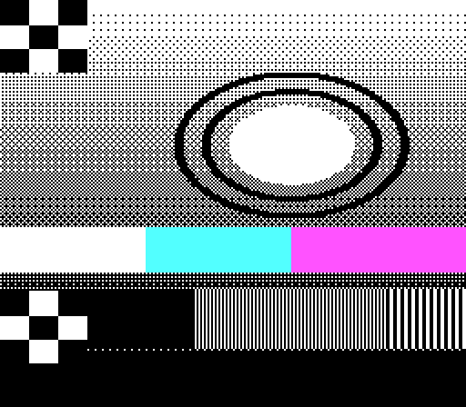
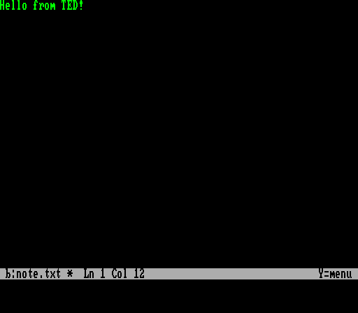
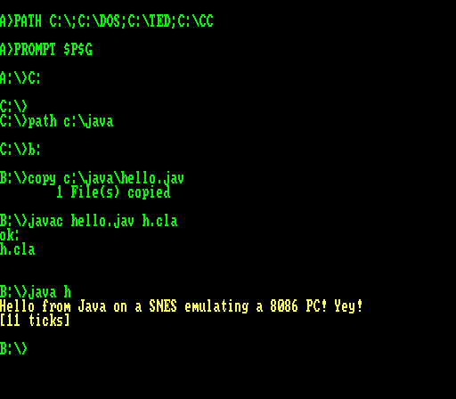
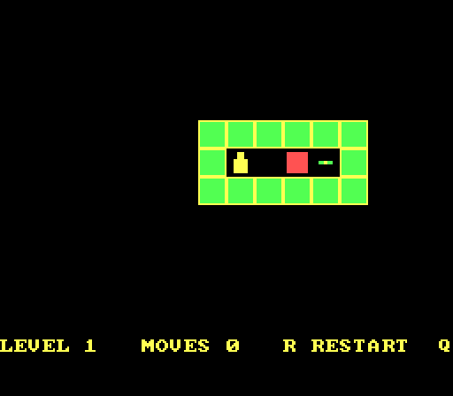

# homebrew/ — the DOS software we wrote

One folder per tool; everything here ships on the `C:` drive of every
DOS ROM this repo builds. One rule to know before playing: all the
tools are *present* everywhere, but the ones that **write** — TED
saving, JAVAC emitting bytecode, the [C compiler](../freeware/cc/README.md) —
need a writable drive, and only the standard machine (`make msdos`) has
one: `B:`, backed by battery SRAM. The 172 KB machines (`make
msdos_big`, `make freedos`) trade `B:` away for RAM.

## MIDI

This is our MIDI playback pair, and the reason the SNES is your sound
card: the SPC-700 audio chip runs an 8-voice General MIDI synth, and
the guest sees a small MIDI card. It works in two steps because 1980s
math was expensive: `MIDCONV` converts a Standard MIDI File (format 0)
into a `.SNM` packet stream — doing the slow real-number timing math
once — so `MIDPLAY` can be a fast dumb loop that streams packets to the
synth. You can test it as such:

    C:\> CD MIDI
    C:\MIDI> MIDPLAY DEMO.SNM
    C:\MIDI> MIDCONV YOURS.MID YOURS.SNM      (bring your own format-0 .MID)

[▶ Watch the demo tune](../docs/assets/mididemo.mp4) — Beethoven's "Ode
to Joy", sequenced as a CC0 MIDI, played through the SPC-700. Even the
PC speaker routes to the synth, so programs that beep make sound.

## VIEW

This is a picture viewer we created: it decodes BMP (8/24/32-bit
uncompressed) and PCX (8-bit RLE) files pixel-by-pixel *on the emulated
8086* and dithers them onto the CGA screen — 640×200 halftone by
default, 320×200 four-colour if you ask. A full paint takes a few
minutes of the image crawling up the screen, exactly as the eighties
intended. L/R pan the 512-pixel window across the 640. You can test it
as such:

    C:\> CD VIEW
    C:\VIEW> VIEW CARD.BMP        the generated test card
    C:\VIEW> VIEW CARD.PCX        same pixels, PCX decoder
    C:\VIEW> VIEW CARD.BMP 4      320x200 four-colour mode
    C:\VIEW> VIEW *.BMP           slideshow: any key = next, ESC = quit

Your own images: any uncompressed BMP up to 2048 pixels wide (convert
with `sips -s format bmp in.jpg --out out.bmp` on macOS), dropped into
`user/` → `C:\USER`.

## TED

This is a visual text editor we created in Turbo Pascal, built to be
driven with a game pad: the d-pad moves the cursor, SELECT opens the
on-screen keyboard for typing, START is Enter, and **Y opens the menu**
(Save / Save As / Load / Search / Goto / Quit) so commands cost zero
keyboard trips. Keystrokes land in ~50 ms — live typing, no interpreter
tricks, it's compiled Pascal. You can test it as such:

    C:\> TED B:NOTE.TXT           (TED is on the PATH — works from anywhere)

Save to `B:` and the file lives in battery-backed cartridge SRAM: power
off, power on, it's still there, like a game save.

## JAVA + JAVAC

"Write once, run anywhere," taken literally. `JAVA.COM` interprets real
`javac` bytecode (shipped as `.CLA`, because DOS 8.3 can't spell
`.class`), and `JAVAC.EXE` is our Java compiler *running on the
machine* — so the SNES compiles Java and then runs it. Compiling takes
a couple of seconds; *running* is the slow part (the sieve interprets
~330K bytecodes in about 3½ minutes and prints its own tick count).
You can test it as such:

    C:\> CD JAVA
    C:\JAVA> JAVA HELLO                      run the shipped bytecode
    C:\JAVA> JAVA SIEVE                      1899 primes, timed in BIOS ticks
    C:\JAVA> JAVAC HELLO.JAV B:HELLO.CLA     compile Java on a SNES
    C:\JAVA> JAVA B:HELLO

(`C:` is read-only, so JAVAC's output goes to the writable `B:`; on the
desktop reference PC, `runpc`, use `A:` instead.)

Details and the supported subset: [java/README.md](java/README.md). How
a 1988 C compiler ended up building JAVAC inside our own emulator:
[docs/notes/javac-porting.md](../docs/notes/javac-porting.md).

## SOKOBAN

Our CGA puzzle game, with source — push the crates onto their targets,
d-pad to move. You can test it as such:

    C:\> CD SOKOBAN
    C:\SOKOBAN> SOKOBAN

## BENCH

The benchmarks and test cards, mostly useful for regression hunting and
bragging: `SIEVE` (the BYTE sieve, ten iterations), `HELLO`, and the two
CGA test cards `CGATEST` (320×200 mode 4) and `CGA6TST` (true 640×200
mode 6 — any key exits back to DOS).

    C:\> CD BENCH
    C:\BENCH> SIEVE
    C:\BENCH> CGA6TST

## And the C compiler

Not ours, so it lives next door: the public-domain **Small-C toolchain**
in [`freeware/cc/`](../freeware/cc/README.md) puts `CC HELLO` at a DOS
prompt on a Super Nintendo. Same machine, same rules, ten glorious
minutes per compile.

---

# Building them

Each tool folder holds the Turbo Pascal source, the committed `.COM`
binary, any generators it owns, and a Makefile with two targets:

- `make stage` — populate `<tool>/build/` with **exactly** what ships on
  the C: drive as `C:\<TOOL>` (binaries and generated data only — no
  Pascal sources: the image can't compile Pascal, so it doesn't ship
  Pascal). The packer (`snes/tools/mkhd_free.py`) walks every `*/build/`
  by convention; adding a tool here needs no packer changes.
- `make recompile` — rebuild the `.COM` from source by driving Turbo
  Pascal 3's IDE inside `runpc`, our own emulated MS-DOS 2.0. TP3 is
  **fetched, not committed** (`fetch_tp3.py`: pinned archive.org image,
  sha256-verified per file, cached in `cache/`; a local
  `disks/tp301.img` is preferred when present). Borland/Embarcadero
  retain all rights to TP3 — we treat it exactly like the ELKS and
  FreeDOS images: fetch at build time, never redistribute.

`make homebrew` from the repo root runs the whole loop: rebuild every
tool from source and verify (see [TESTING.md](../TESTING.md)).

The shared machinery lives here at the top: `tpcompile.sh` (the compile
driver: `sh tpcompile.sh <tool> <name>`), `mk_tpc_img.py` (builds the
scratch boot floppy from `msdos/msdos.img`), `fatimg.py` (FAT12
plumbing), `fetch_tp3.py`, and `vdbg.pas` — a scratch harness that runs
`inline()` machine-code blocks in the TP3 IDE with text output, the
fast loop for developing inline asm (copy your experiment into
`vdbg.pas` and run `sh tpcompile.sh . vdbg`).

| dir | ships as | what |
|---|---|---|
| `view/` | `C:\VIEW` | BMP/PCX viewer + the generated test cards |
| `ted/` | `C:\TED` | the editor (on the DOS PATH) |
| `java/` | `C:\JAVA` | JAVA.COM + JAVAC.EXE + sample `.JAV`/`.CLA` |
| `midi/` | `C:\MIDI` | MIDPLAY/MIDCONV + the generated CC0 demo tune |
| `sokoban/` | `C:\SOKOBAN` | the game |
| `bench/` | `C:\BENCH` | SIEVE/HELLO + the CGA test cards |

Sample data policy: `java/samples/` keeps the `.java` sources and the
`javac --release 8` bytecode committed together (`samples/mkjava.sh`
rebuilds them when a JDK is around). The rule everywhere is *ship
source only if the machine itself could build it* — and it passes
twice: the image ships the five `.JAV` sources, because JAVAC on the
machine compiles them, and `C:\CC` ships `HELLO.C`/`SIEVE.C`, because
the Small-C toolchain builds them. Pascal sources stay repo-only: the
image has no Pascal compiler.

## Turbo Pascal 3 lessons (paid for; do not re-learn)

- **Sources must be CRLF.** LF-only source "compiles" to a broken
  program with no error. Keep every `.pas`/`.inc` CRLF; when patching
  from Python, use `\r\n` strings and assert every replacement.
- **TP3 keeps SS ≠ DS.** Locals are `SS:[BP+x]` — invisible to
  DS-relative `inline()` machine code, and `[bp]` stores go to the
  stack segment. Inline-loop state lives in *globals*; memory writes go
  through `ES:DI` after `push ds / pop es`. DOS-call pointers to locals
  need `Seg(x)`, not `DSeg`.
- **Parameters need named string types** (`type Str80 = string[80]`),
  bare `string` params don't compile.
- **Typed constants are CS-relative** — never reference them from
  `inline()`.
- **No 32-bit integers.** File offsets and Java ints alike are word
  pairs; VIEW reads files strictly forward so it never needs a 32-bit
  seek.
- TP3 compiles `x*3` to a real 8086 `MUL` (~120 cycles); write
  `x+x+x`. At snes86 speed every instruction in a per-pixel loop is
  about a minute of total runtime — see `view/mkviewasm.py` for the
  generated-machine-code approach when Pascal isn't fast enough.
